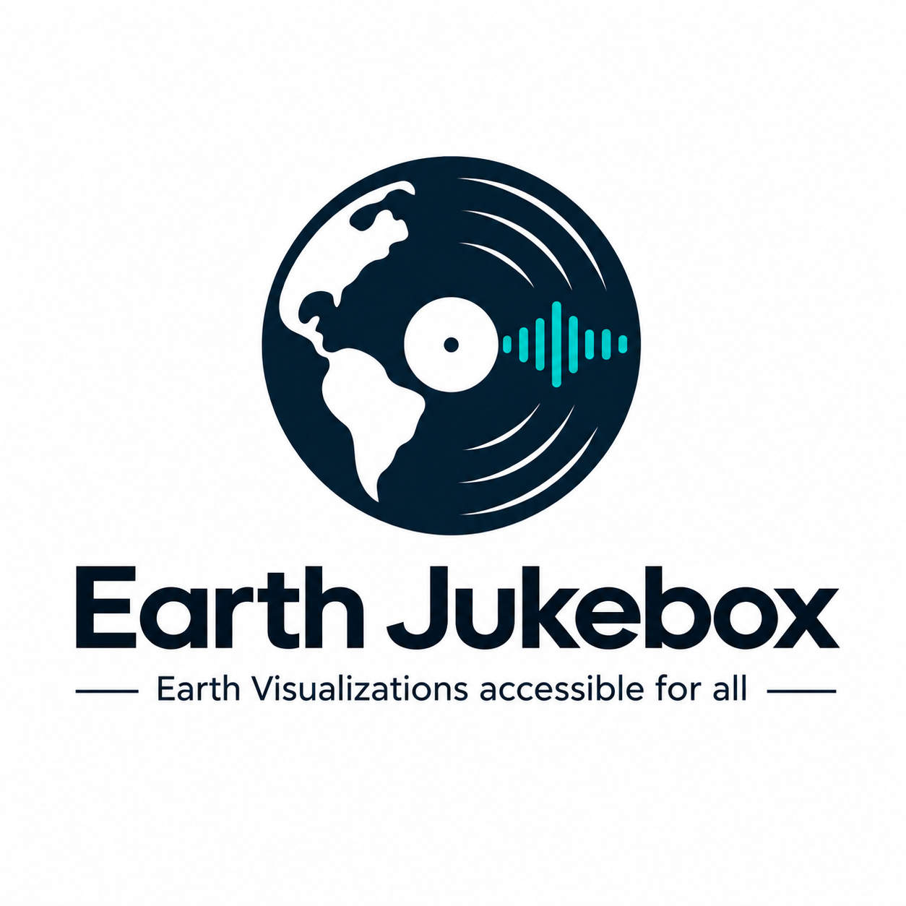

# Earth Jukebox

NASA's Earth Information Center shows our planet in pictures, and those pictures store their data as colour. If you cannot see the colours, the data is out of reach. Earth Jukebox reads the colours back into what they stand for and tells you, in sound and in words.

**Point** at any spot of a visualization and you hear a tone and get a label: "Warm water, about 26 °C. Indian Ocean (12°S, 80°E)". **Play** it and the parts of the picture, such as north, tropics and south, take turns as notes while each one is named on screen.

Made by team Planet Playback for the 2026 NASA Space Apps Challenge, challenge "The Earth Information Jukebox".

## Try it

**Online:** https://mcforum.github.io/earth-jukebox/

**30-second demo video:** [Earth-Jukebox-Demo.mp4](Earth-Jukebox-Demo.mp4). Its voice-over is synthetic speech, and its labels and tones were computed with the project's own colour decoders.

**On your own computer (Windows):**

1. Download this repository and unzip it.
2. Double-click `start.bat`. It needs Node.js; if Node.js is missing it falls back to Python.
3. Your browser opens `http://localhost:8137`.

Opening `index.html` directly from disk does not work, because browsers do not let a page read the pixels of a local video file.

## What it does

| You do | You get |
|---|---|
| Move the mouse over the picture | A tone that rises with the value under the pointer, and a label with the value and the place |
| Hold the mouse still | The voice guide reads the label out |
| Click the picture and use the arrow keys | The same, without a mouse: a pointer moves across the picture, Enter reads the spot out |
| Press Play | The parts of the picture play one after another, each outlined and labelled while it sounds, with a one-line summary under the picture |
| Press a button under "What you hear" | An example of each sound, so you can learn the scale first |
| Press "Describe this" | A spoken description: what the visualization shows, what the colours mean, how it sounds, and the current values |
| Drop in your own picture or video | The same pointing and playing, with brightness and colour names instead of a calibrated scale |

Nothing is recorded in advance. Every sound is generated in the moment from the picture on screen.

## How a colour becomes a value

About ten times a second the current frame is drawn onto a 192 × 108 analysis canvas. Each record has a small decoder (`records.js`) that turns a pixel colour into a data value or "no data":

| Record | How the colour is read | Sound |
|---|---|---|
| A1 Sea surface temperature and currents | Rainbow scale: blue 0 °C, green about 15 °C, yellow 25 °C, red 32 °C; grey is land | Higher note = warmer |
| A2 Aerosols in the air | Orange/red smoke, green sulfate, pink dust, blue/white sea salt | One instrument per particle type |
| A3 Lightning seen from the Space Station | Yellow dots are flashes | Ticks like a Geiger counter: more ticks = more lightning; high, middle and low ticks are north, tropics and south |
| A4 Wildfire smoke and air quality | Stronger colour = more pollutant, in four colour groups | Higher and louder = more |
| B1 A river in the sky | Stronger blue = more water vapour on the move | Higher and louder = more |
| B2 How tall the forest is | Blue is sea; brighter green = taller forest | Higher note = taller |
| B3 Carbon dioxide around the globe | Brightness | Higher and louder = brighter |
| B4 Night lights, 2012 to 2023 | Brightness | Higher and louder = more light |

Limits, stated plainly: the temperature and particle readings come from the colour scale, so they are estimates, not the original model values. Place names on the two flat world maps are coarse boxes. "A little, some, a lot" compares each part with the busiest moment of that record so far. B3 and B4 only read brightness.

## Browser extension: Earth Jukebox Lens

The same layer also works directly on NASA's own pages. The folder `extension/` is a Chrome extension that adds a "hear this picture" button to pages of NASA's Scientific Visualization Studio (svs.gsfc.nasa.gov) and lays the lens over the largest picture or video there.

1. Open `chrome://extensions` and switch on "Developer mode".
2. Click "Load unpacked" and choose the `extension` folder.
3. Open a visualization, for example https://svs.gsfc.nasa.gov/3912/, and press the yellow button in the bottom right corner.

On the pages of the eight records above the extension uses their calibrated colour scale; everywhere else it reads brightness and colour names.

## Accessibility

- Everything works from the keyboard: Space (play or pause), 1 to 8 (pick a record), D (describe); on the picture the arrow keys move the pointer, Shift moves it faster, Enter reads the spot out.
- Spoken output uses the browser's own speech synthesis; with the voice guide off, the same text goes to a live region for screen readers.
- All controls have text labels, focus is always visible, and text contrast is high.

## Files

| File | What it is |
|---|---|
| `records.js` | The records: descriptions, colour decoders, zones, place names |
| `lens.js` | The lens: reads the picture, makes the sound, draws labels, handles pointer and keyboard |
| `app.js`, `index.html`, `style.css` | The jukebox page around the lens |
| `extension/` | The Chrome extension (uses the same `records.js` and `lens.js`) |
| `media/` | The NASA visualizations, scaled down and shortened with ffmpeg |
| `server.js`, `start.bat` | Optional local server that only listens on your own computer |

Plain HTML, CSS and JavaScript with the Web Audio API. No frameworks, no external libraries, no tracking, no network requests after loading. A strict Content Security Policy is set in `index.html`.

## NASA sources

- https://svs.gsfc.nasa.gov/3912/ Global Sea Surface Currents and Temperature
- https://svs.gsfc.nasa.gov/5669/ GEOS Aerosols
- https://svs.gsfc.nasa.gov/5011/ Lightning Events Detected from the ISS 2017-2023
- https://svs.gsfc.nasa.gov/5533/ Air Quality Model Runs
- https://svs.gsfc.nasa.gov/4960/ A 3D View of an Atmospheric River from an Earth System Model
- https://svs.gsfc.nasa.gov/4950/ GEDI Forest Height
- https://svs.gsfc.nasa.gov/5196/ DYAMOND Global Carbon Dioxide
- https://svs.gsfc.nasa.gov/5313/ Change in Night Lights between 2012 and 2023 - EIC Version

## Use of AI

The code and the texts of this project were written with the help of Claude, an AI assistant made by Anthropic. The idea, the selection of NASA visualizations, testing and the final decisions were made by the team. The NASA visualizations were not altered by AI; they were only scaled down and shortened.

## Credits

Visualizations: NASA's Scientific Visualization Studio and the NASA Earth Information Center. NASA does not endorse this project. Code: MIT License, see `LICENSE`.
